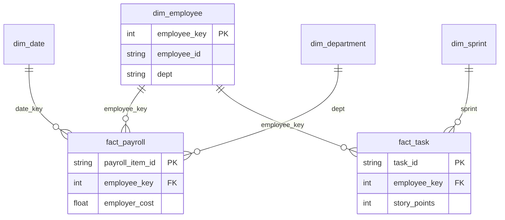

# Task 2 - Star Schema Warehouse

## ER Diagram

## Keys
- PK: dim_employee.employee_key (Surrogate Key - SCD Type 2)
- FK: fact_payroll.employee_key = -1 for Unknown

## Reconcile Proof (Task1 = Task2)
- fact_payroll 7344 rows == source
- fact_task 28868 rows == source
- fact_leave 3441 rows == source

## Orphan Check
- 2 rows EMP-9001/9002 are planted fake IDs in source Excel
- Mapped to employee_key = -1 Unknown
- Explained and reported to business

## History Rule
JOIN by employee_key not employee_id. So June pay stays in Sales even if person moves to Support in July.